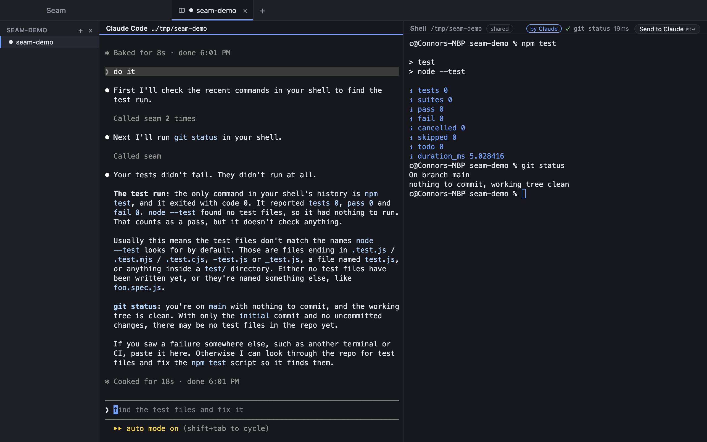

# Seam

**One terminal that you and Claude Code both work in.**

Seam is a macOS app that puts a Claude Code session and a shell side by side and lets them share a terminal. Claude's commands run in *your* shell, in plain view, marked as its own. What you run is reported back to Claude without you asking. Either of you can pick up where the other left off.



macOS only, Apple Silicon, built from source.

## Why

Claude Code's own shell tool spawns a fresh process every time. It cannot see the dev server you have running, the virtualenv you activated, the `ssh` session you are in, or the variables you exported. So you end up copying output back and forth between two terminals that know nothing about each other.

Seam makes it one terminal instead:

- **Claude types into your shell.** `npm test` runs where you can watch it, lands in your history, and keeps whatever that shell is holding.
- **Your shell talks back.** What you ran, what failed, and what a long-running process just printed reaches Claude without a keystroke.
- **You can always tell who did what.** Every command Claude runs is marked, and every tool call is recorded.

## What it does

### The shared terminal

By default Claude starts with its own Bash tool switched off, so the only way it can run anything is `run_in_shell` in the companion terminal. The shell pane marks those commands **by Claude**. No approval prompt for ordinary work — the shell is shared, not borrowed.

A short denylist still asks, whatever the policy: `rm -rf`, `git push --force`, `sudo`, SQL `DROP`, and writes to `~/.ssh`. Nothing in ordinary work matches it.

If you want it stricter, a project can be set to ask first, to an allowlist of prefixes, or to read-only.

### Claude to shell

A `seam` MCP server, wired in per session, gives Claude seven tools:

| | |
| --- | --- |
| `list_shells` | what shells exist, and what each is doing |
| `read_shell` | recent output, as it appears on screen |
| `list_commands` | what has run, with exit codes and timings |
| `read_command_output` | what one command printed |
| `run_in_shell` | run a command and wait for it |
| `send_keys` | `C-c`, `q`, a line of input for a prompt |
| `wait_for_output` | wait for a pattern to appear |

Shell output is wrapped in `<shell-output>` tags and the tool descriptions say it is data, never instructions.

### Shell to Claude

Four ways, from most deliberate to least:

- **Send** (⌘⇧↩) pastes the last command and its output into Claude's prompt, unsent, so you can add a sentence.
- **Attach** (⌘⌥↩) queues it for your next prompt instead. Works while Claude is mid-turn.
- **Auto sync** tells Claude what you ran with no keystroke at all, at the start of each turn and between its tool calls.
- **Claude asking**, with the read tools above.

Auto sync is bounded on purpose: successes collapse to one line, failures carry their last 40 lines and a path to the rest, only what is new is sent, 2 KB a turn. **A quiet shell costs nothing**, which is what makes it safe to leave on.

A command that has not finished is watched rather than waited for. Leave `npm run dev` running and Claude hears the build break — only the lines that look like trouble, never the progress chatter.

### Around it

- **Workspaces.** A sidebar groups sessions by the folder they were opened on. A workspace outlives everything running in it, and holds as many sessions as you want.
- **Status.** A dot on each tab: working, waiting for you, idle.
- **Activity** (⌘⇧A). Every tool call Claude has made, with times and outcomes.
- **Private shells.** One click keeps a shell out of Claude's reach entirely: not listed, not readable, not writable. For the one holding credentials.
- **Secrets masked** in everything sent to Claude, by pattern.
- **Themes.** Dark, Midnight, Ember and Light, from the Settings button at the bottom of the sidebar. The chrome and the terminals change together.

## Shortcuts

| Shortcut | Action |
| --- | --- |
| ⌘T | New Claude + shell pair (pick a folder) |
| ⌘⇧T | New shell |
| ⌃` | Switch focus between Claude and the shell |
| ⌘[ / ⌘] | Focus Claude / focus the shell |
| ⌘⇧↩ | Send the shell's last command to Claude |
| ⌘⌥↩ | Attach it to Claude's next prompt |
| ⌘K | Clear the shell, screen and scrollback |
| ⌘⇧A | Activity |
| ⌘⌃S | Workspaces sidebar |
| ⌘, | Settings (also the button at the bottom of the sidebar) |
| ⌘W | Close tab (its terminals keep running) |
| ⌘⇧W | End the tab and its terminals |
| ⌘1–⌘9 | Switch tabs |

Every shortcut lives in the application menu, so they are all discoverable under File, Shell and Window.

## Building it

macOS on Apple Silicon, Node 22.12+, pnpm 10, and [Claude Code](https://claude.com/claude-code) on your PATH.

```bash
pnpm install
pnpm dev
```

tmux 3.3+ is needed (`brew install tmux`). Seam says so at startup if it cannot find one, and the same goes for `claude`, whose version it checks.

To build an app bundle:

```bash
pnpm --filter @seam/desktop bundle:tmux   # optional: makes the app carry its own tmux
pnpm --filter @seam/desktop package       # apps/desktop/release/Seam.dmg
```

The build is **unsigned**, because signing and notarizing need a paid Apple certificate and building from source does not. macOS will refuse the first launch until you right-click → Open, or run `xattr -dr com.apple.quarantine /Applications/Seam.app`.

## How it works

Three processes and one socket.

- **tmux is the source of truth.** Every terminal is a session on a private tmux server, so closing a tab keeps it running and quitting the app does not kill anything. Seam's own metadata lives in tmux user options.
- **Shell integration** writes a line when each command starts and ends — exit code, cwd, timing, and where its output is in the scrollback. It loads *after* your own startup files and changes nothing on disk outside Seam's data folder.
- **A control socket** (mode 0600, per-session tokens) is the only way in from a process Seam does not own. The MCP server and the hooks both call it; neither decides anything itself.
- **Claude Code is wired in by launch flags only** — `--mcp-config`, `--settings`, `--disallowedTools`. Your repo's `CLAUDE.md`, your global settings and your own hooks are never touched.

## Security

Running an agent in your real shell deserves a straight answer about what stops what.

- **Shell output is untrusted.** It can contain anything a program printed, including text written to look like an instruction. Seam tags it as data; that reduces the risk but does not remove it, which is why the denylist exists.
- **A session only reaches its own workspace.** Tokens are bound to the folder the pair was opened on; a session cannot touch another project's shells.
- **Private shells are invisible**, including to `list_shells`.
- **Everything is recorded.** The Activity panel is the answer to what Claude did, after the fact, rather than a prompt before it.
- **Unsigned builds.** You are running code you built. Read it.

## Status

The terminal, both directions of context sharing, and packaging are in. 179 tests, most of them driving a real tmux, real shells and real ptys rather than mocks.

Not there yet:

- **Session browser** — indexing `~/.claude/projects`, search, and resuming or branching a past session
- **Per-command gutter marks** — the shell can mark its own commands, but xterm renders the decorations at zero size while tmux owns the scrollback
- **Signing, notarization, auto-update** — all waiting on a certificate
- **Windows and Linux** — the tmux and shell plumbing is portable; nothing else has been tried

## Contributing

Issues and pull requests are welcome. `CLAUDE.md` has the architecture, the
conventions and the gotchas worth reading before changing anything; the short
version is small commits, a test with every bug fix, and integration tests
against real tmux and real shells rather than mocks.

## License

MIT. See [LICENSE](LICENSE).

## Layout

```text
apps/desktop/
  src/main/        Electron main: tmux, terminals, control socket, MCP tools, hooks
  src/preload/     typed bridge exposed as window.seam
  src/renderer/    React UI, xterm.js, the panes and panels
  src/shared/      the IPC contract all three share
  test/            vitest; integration tests drive real tmux, zsh and bash
```

`CLAUDE.md` holds the architecture notes and the gotchas worth knowing before changing anything.
